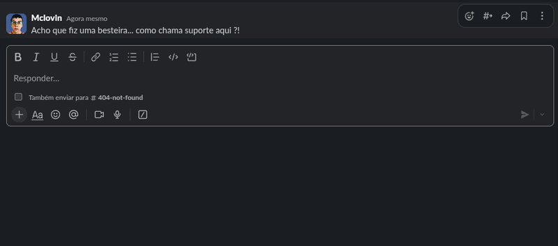
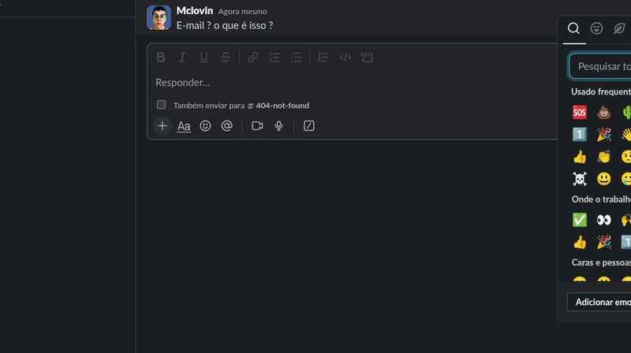
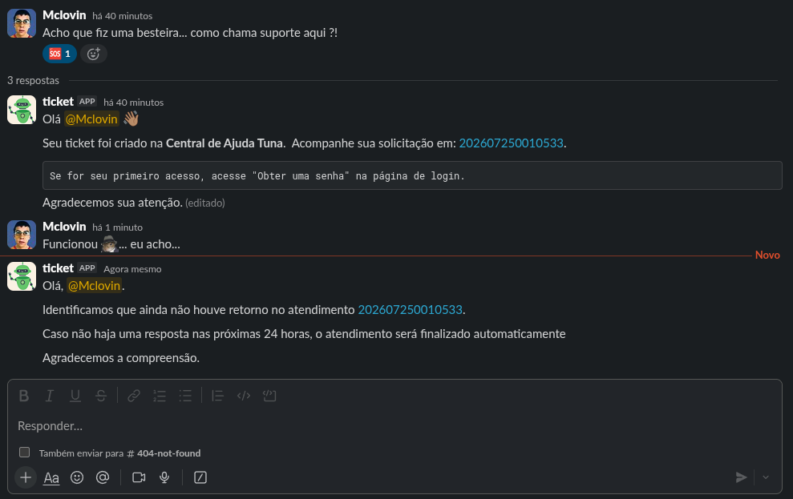
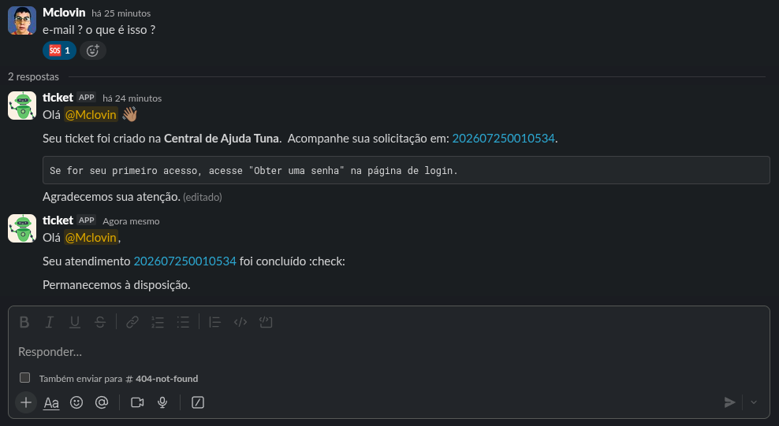
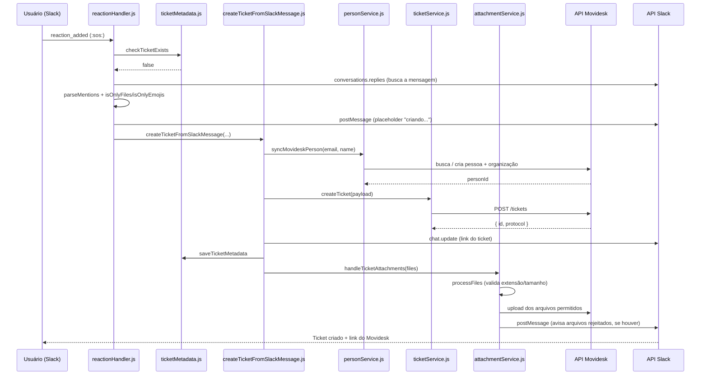

<div align="center">


[](https://nodejs.org/)
[](https://www.typescriptlang.org/)
[](https://slack.dev/bolt-js/)
[](https://expressjs.com/)
[](https://www.postgresql.org/)
[](https://vitest.dev/)
[](LICENSE)

**Integração Slack to Movidesk para abertura e gestão automática de tickets de suporte**

</div>

---

Bot de Slack que integra o time de suporte da Tuna Pagamentos ao Movidesk.
Qualquer pessoa no workspace pode abrir um ticket de suporte reagindo com
🆘 em uma mensagem - o bot cria o chamado no Movidesk automaticamente,
sem sair do Slack.

## Funcionalidades

- **Criação de ticket por reação**: reagir com 🆘 -> `:sos:` em qualquer mensagem
  (ou thread) abre um ticket no Movidesk com o conteúdo da mensagem.

- **Coleta de e-mail via modal**: se o autor da mensagem não tem e-mail
  cadastrado no Slack, o bot pede via um modal antes de criar o ticket.

- **Anexos**: arquivos anexados à mensagem original são enviados junto ao
  ticket - com validação de extensão permitida e tamanho máximo (20 MB).
  Arquivos rejeitados são listados numa mensagem de aviso, sem travar a
  criação do ticket.

- **Vínculo automático de organização**: o e-mail do usuário é usado para
  identificar a empresa/relacionamento no Movidesk (ex: domínio
  `@empresa.com.br` vincula automaticamente à organização da empresa).

- **Notificações automáticas** (via webhook do Movidesk): o bot avisa no
  Slack quando um ticket é resolvido, quando passa 24h sem resposta do
  cliente, e alerta o canal de suporte sobre chamados dedicados/urgentes.
  Veja [`docs/API.md`](docs/API.md) para detalhes de cada endpoint.

- **Home Tab**: mostra o total de tickets abertos pelo bot direto na aba
  Home do app no Slack.

- **Prevenção de duplicidade**: reagir duas vezes na mesma mensagem não
  cria um segundo ticket; notificações de webhook também não são reenviadas.

## Demonstração do Fluxo

### 1. Abertura via Reação `🆘`


### 2. Coleta de E-mail (quando necessário)


### 3. Notificação de 24h sem resposta


### 4. Ticket Resolvido


## Fluxo de criação de ticket



## Arquitetura (estrutura de pastas)

```
src/
├── app.js                    # configuração do Bolt/Express e registro de rotas/eventos
├── server.js                 # ponto de entrada, inicia o servidor
├── config/
│   └── env.js                 # carrega e centraliza todas as variáveis de ambiente
├── controllers/
│   └── webhookController.js   # handlers HTTP dos webhooks (fino, delega pra notifications/)
├── routes/
│   └── webhookRoutes.js       # mapeamento de rotas Express
├── events/                    # listeners de eventos do Slack (Bolt)
│   ├── reactionHandler.js     # reaction_added (:sos:)
│   ├── emailModal.js          # modal de coleta de e-mail
│   └── appHome.js             # app_home_opened
├── notifications/
│   └── ticketNotifications.js # lógica das 4 notificações de webhook
├── db/
│   ├── connection.js           # pool de conexão PostgreSQL
│   └── queries/                 # uma responsabilidade por arquivo
│       ├── ticketMetadata.js    # vínculo ticket <-> thread do Slack
│       ├── ticketMetrics.js     # contador global de tickets
│       └── webhookStatus.js     # controle de duplicidade de notificações & notificações no canal do ONLY
└── services/
    ├── slack/                  # utilidades específicas do Slack
    │   ├── mentionParser.js     # resolve <@ID> pra nome real
    │   ├── messageValidator.js  # detecta mensagem só-arquivo / só-emoji
    │   └── threadContext.js     # monta link da thread pro ticket no Movidesk
    ├── files/                  # validação e upload de anexos
    │   ├── fileValidator.js
    │   ├── attachmentFilter.js
    │   ├── attachmentUploader.js
    │   └── attachmentService.js
    ├── movidesk/                # toda integração com a API do Movidesk
    │   ├── people/               # Api (HTTP puro) + Service (orquestração)
    │   ├── tickets/               # idem
    │   └── organizations/
    │       └── relationshipResolver.js  # domínio de e-mail -> organização
    └── ticketFlow/
        └── createTicketFromSlackMessage.js  # orquestra o fluxo completo de criação do tkt
```

**Padrão adotado**: módulos que fazem chamada HTTP externa são separados em
`xApi.js` (requisição pura) + `xService.js` (orquestração/regra de negócio),
seguindo o exemplo de `movidesk/people/` e `movidesk/tickets/`.

## Stack

- Node.js (ESM) + Express
- [Slack Bolt](https://slack.dev/bolt-js/) - framework oficial de apps Slack
- PostgreSQL ([`pg`](https://node-postgres.com/)) - hospedado no Railway
- [Vitest](https://vitest.dev/) - testes unitários
- Movidesk API - helpdesk onde os tickets são criados/gerenciados

## Pré-requisitos

- Node.js >= 18
- Uma instância PostgreSQL acessível (local ou remota)
- Um app Slack configurado (Bot Token + Signing Secret) com os eventos
  `reaction_added` e `app_home_opened` habilitados
- Token de API do Movidesk

## Configuração

1. Clone o repositório e instale as dependências:
   ```bash
   git clone https://github.com/eduardotashiro/movidesk-ticket.git
   cd movidesk-ticket
   npm install
   ```

2. Copie o arquivo de exemplo e preencha com suas credenciais:
   ```bash
   cp .env.example .env
   ```
   Veja a seção [Variáveis de ambiente](#variáveis-de-ambiente) abaixo para
   o que cada chave significa.

3. Configure o banco de dados executando o script de schema fornecido:
   ```bash
   psql $DATABASE_URL -f src/db/schema.sql
   ```
   Como alternativa, execute o conteúdo do arquivo [`schema.sql`](src/db/schema.sql) utilizando um cliente SQL compatível com PostgreSQL, como DBeaver ou pgAdmin.

## Rodando localmente

```bash
npm run dev        # com nodemon, reinicia ao salvar
npm start          # sem nodemon, produção
npm run tunnel      # expõe a porta 3000 via ngrok (necessário para os
                     # eventos do Slack chegarem no seu ambiente local)
```

Depois de subir o `ngrok`, atualize a **Request URL** em Event Subscriptions e Interactivity & Shortcuts
no painel API do seu app Slack com a URL gerada.

## Via Docker

Se você tem Docker e Docker Compose instalados, pode subir a aplicação e o banco de dados com um único comando:

**Garanta que o arquivo .env está preenchido**
# 1. Suba os containers
```bash
docker compose up -d --build
```

# 2. Para ver os logs em tempo real
```bash
docker compose logs -f app
```

## Testes

```bash
npm test            # roda a suíte inteira uma vez
npm run test:watch  # modo watch, reroda ao salvar
```

A suíte cobre os módulos de negócio puros e com integração externa mockada
(validação de mensagem/arquivo, montagem de payload do Movidesk, sincronização
de pessoa, resolução de organização por domínio, upload de anexo). Nenhum
teste bate em banco, Slack ou Movidesk reais.

## Variáveis de ambiente

Veja [`.env.example`](.env.example) para a lista completa. Os grupos principais:

| Grupo | Descrição |
|---|---|
| `SLACK_*` | credenciais do app e URL base para montar links de thread |
| `URL_*` / `MOVIDESK_TOKEN` | endpoints e token da API do Movidesk |
| `DATABASE_URL` | string de conexão PostgreSQL |
| `*_ID` / `*_NAME` / `*_SLA` | mapeamento de domínio de e-mail para organização no Movidesk (ex: `ANGELONI_ID`, `TUNA_SLA`) |

## Documentação adicional

- [`docs/API.md`](docs/API.md) - endpoints de webhook, payloads e exemplos de teste com `curl`

## Referências

- [Ticket API](https://atendimento.movidesk.com/kb/pt-br/article/256/movidesk-ticket-api)  

- [Person API](https://atendimento.movidesk.com/kb/pt-br/article/189/movidesk-person-api)  

- [Attachments API](https://atendimento.movidesk.com/kb/pt-br/article/518585/api-de-anexos)

---

<div align="center">

**Made with 💀 by [Eduardo Tashiro](https://github.com/eduardotashiro)**

⭐ **Star this repo if you find it useful!**

[](https://github.com/eduardotashiro/movidesk-ticket/stargazers)

</div>